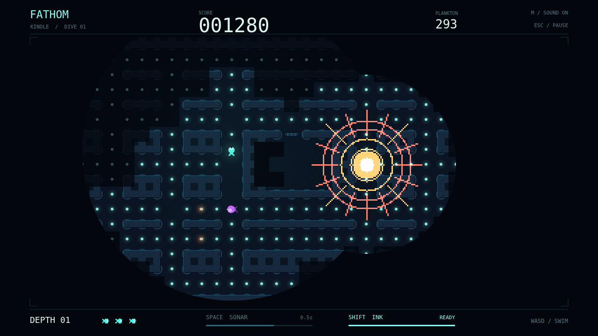

# Fathom

**Your light keeps you alive. It also tells the deep where you are.** Slip into a flooded maze as a tiny glowing forager and graze the plankton scattered through its corridors. Every meal makes your light swell, opening a wider circle of the trench — and drawing the attention of things with teeth.

The water remembers what you've seen, but you can only read that memory inside the circle you carry. Send a cyan sonar pulse around a blind corner to find the passage ahead. Watch it split at a junction, touch the rock, and briefly outline a hunter. Then decide whether knowing was worth making a sound.

Three predators read three different signals. The Lanternjaw follows your glow, its amber lure indistinguishable from a harmless drifting meal. The eyeless Gloamfin listens, answering your pulses with violet ripples of its own. And the Flarefish disappears between sudden, searing blooms that expose the maze straight through stone. An ink cloud buys a moment against eyes, but not against ears.

Find a rhythm: eat, dim, listen, turn. Sweep every last mote from the maze to earn the descent bonus and dive deeper, where more hunters patrol and your sonar reaches less far. You have three lives in reserve, a small light, and whatever you can remember of the way home.

